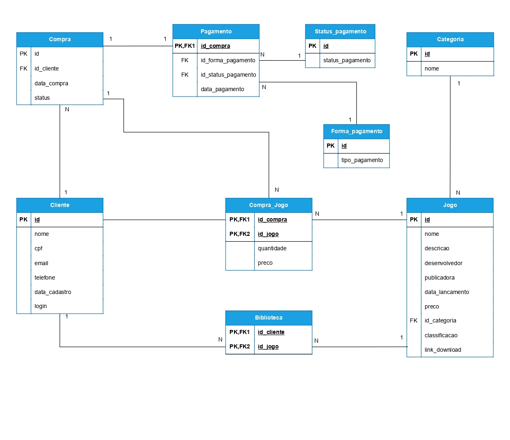

# PlayCommerce

Projeto desenvolvido para fins de prática e estudo de modelagem de dados. A proposta é traduzir o diagrama relacional elaborado na faculdade para entidades Java e mapeamentos com JPA.

## Objetivo e escopo

O foco está nas tabelas, chaves e associações do diagrama, não na implementação de uma plataforma comercial completa. As entidades representam clientes, compras, itens de compra, jogos, categorias, pagamentos, formas e status de pagamento, além da biblioteca de jogos do cliente.

O modelo permite praticar relações um-para-muitos, um-para-um e muitos-para-muitos. `Compra_Jogo` também representa uma associação com atributos próprios, como quantidade e preço.

Os endpoints e serviços existentes servem como apoio para exercitar a persistência e a consulta dessas estruturas. Eles não implementam regras completas de negócio nem integração real com pagamentos. `link_download` é um atributo do jogo; não há serviço de download. A autenticação JWT presente no código é experimental e não é o objetivo central do projeto.

## Diagrama



## Tecnologias

- Java 17
- Spring Boot e Spring Data JPA
- H2 para execução local e testes
- Driver PostgreSQL
- Spring Security e JWT (experimento adicional)
- Maven
- JUnit e Mockito

## Executar

Requer Java 17. Para iniciar a aplicação:

```bash
bash mvnw spring-boot:run
```

A configuração atual usa H2 em memória e carrega dados de exemplo de `src/main/resources/data.sql`.

## Testes

```bash
bash mvnw test
```
