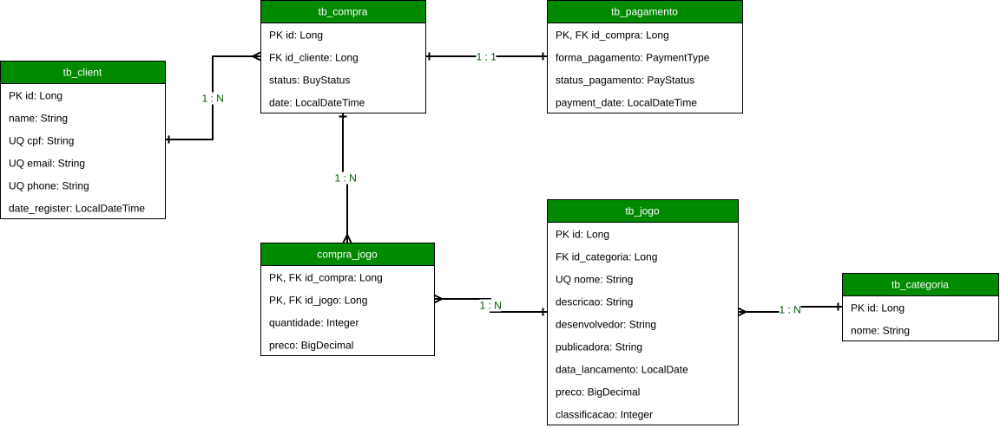

# PlayCommerce

Projeto acadêmico desenvolvido para praticar modelagem de dados relacionais e sua implementação em Java com Spring Boot e JPA. O ponto de partida foi um DER elaborado durante a faculdade; a aplicação existe como exercício de persistência, regras de compra e organização de uma API REST.

> Este não é um produto comercial e não distribui jogos, licenças ou conteúdo protegido. Os dados cadastrados são fictícios e servem apenas para demonstrar o modelo.

## Objetivo de aprendizado

- Traduzir um modelo relacional em entidades JPA.
- Trabalhar relações `1:N`, `1:1` e uma chave composta.
- Criar um fluxo transacional de compra com itens e pagamento.
- Organizar uma API REST pequena, com DTOs, validações, exceções e testes unitários.

## Modelo de dados



O diagrama também está disponível em [SVG](docs/diagram.svg).

O modelo foi reduzido intencionalmente às entidades principais:

| Entidade | Responsabilidade |
|---|---|
| `Client` | Representa quem realiza uma compra. |
| `Category` e `Game` | Formam o catálogo de jogos. |
| `Buy` | Agrupa cliente, itens, status e pagamento. |
| `BuyGame` | Registra jogo, quantidade e preço na compra; usa chave composta. |
| `Payment` | Registra método e status do pagamento; compartilha a chave da compra com `@MapsId`. |

## Tecnologias

- Java 17
- Spring Boot 3
- Spring Data JPA / Hibernate
- H2 para execução local e testes
- Maven
- JUnit 5 e Mockito

## Como executar

Pré-requisito: Java 17.

```bash
bash ./mvnw spring-boot:run
```

A aplicação usa H2 em memória e carrega categorias, jogos e um cliente fictício a partir de `src/main/resources/data.sql`.

## Endpoints principais

| Método | Rota | Descrição |
|---|---|---|
| `POST` | `/api/clients` | Cadastra um cliente. |
| `POST` | `/api/games` | Cadastra um jogo em uma categoria existente. |
| `GET` | `/api/games` | Lista o catálogo. |
| `GET` | `/api/games/{id}` | Busca um jogo. |
| `POST` | `/api/buy` | Cria uma compra com itens e pagamento. |
| `GET` | `/api/buy/{id}` | Busca uma compra. |
| `GET` | `/api/buy/history/{clientId}` | Lista as compras de um cliente. |

### Exemplo de compra

```json
{
  "clientId": 1,
  "status": "PENDING",
  "items": [
    {
      "gameId": 1,
      "quantity": 1
    }
  ],
  "payment": {
    "paymentMethod": "PIX",
    "paymentStatus": "PENDENTE"
  }
}
```

O serviço valida a existência do cliente e dos jogos, impede itens duplicados na mesma compra e registra o preço atual do catálogo em cada item.

## Testes

```bash
mvn test
```

Os testes cobrem o fluxo de compra, o catálogo, o cadastro de clientes, o controller de compras e a inicialização do contexto Spring.

## Escopo intencionalmente limitado

O projeto não implementa autenticação, integração com gateway de pagamento, distribuição de arquivos, licenciamento, carrinho ou estoque. Essas ausências são deliberadas: o objetivo é manter um exemplo pequeno e organizado para estudo de modelagem relacional e JPA.
